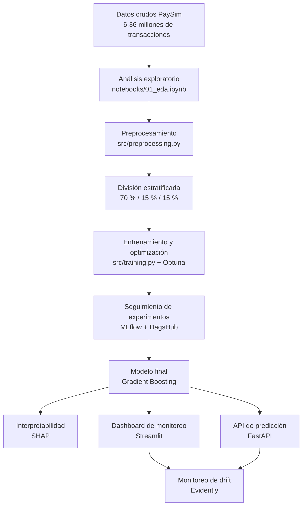

# 🛡️ Sentinel Fraud ML — Detección de Fraude en Tiempo Real

**Proyecto del Curso III — Especialización en Machine Learning Engineering**

- **Autor:** Edwin Carlo
- **Fecha:** Octubre 2026
- **Repositorio:** [Sentinel-fraud-ml](https://github.com/Edwin-Carlo/Sentinel-fraud-ml)
- **Experimentos MLflow:** [DagsHub](https://dagshub.com/Edwin-Carlo/Sentinel-fraud-ml/experiments)
- **Versión:** v1.0.0

---

## 📌 Tabla de contenidos

1. [Problema de ML y diagrama de flujo](#1-problema-de-ml-y-diagrama-de-flujo)
2. [Dataset y diccionario de datos](#2-dataset-y-diccionario-de-datos)
3. [Técnicas de optimización de hiperparámetros](#3-técnicas-de-optimización-de-hiperparámetros)
4. [Model Card](#4-model-card)
5. [Resultados y métricas](#5-resultados-y-métricas)
6. [Análisis e interpretación (SHAP)](#6-análisis-e-interpretación-shap)
7. [Conclusiones](#7-conclusiones)
8. [Estructura del repositorio](#8-estructura-del-repositorio)
9. [Instrucciones de ejecución](#9-instrucciones-de-ejecución)
10. [Estrategia de Git y GitHub](#10-Estrategia-Git-y-GitHub)
11. [Tests](#11-tests)
12. [Referencias](#12-referencias)

---

## 1. Problema de ML y diagrama de flujo

### 📋 Definición del problema

**Detección de fraude en transacciones de dinero móvil** mediante clasificación binaria supervisada. El objetivo es identificar transacciones potencialmente fraudulentas para facilitar una intervención oportuna antes de que se complete el movimiento de fondos.

| Aspecto | Descripción |
|---|---|
| Tipo de Machine Learning | Aprendizaje supervisado |
| Subconjunto | Clasificación binaria |
| Variable objetivo | `isFraud` ∈ {0, 1} |
| Métrica principal | F1-score |
| Métricas secundarias | Precision, Recall, ROC-AUC y PR-AUC |
| Umbral de clasificación evaluado | 0.3118 |

### 🎯 Objetivo de negocio

Proporcionar al equipo de riesgos una herramienta para **priorizar transacciones sospechosas**, reducir las pérdidas económicas asociadas al fraude y facilitar la revisión de operaciones potencialmente fraudulentas.

En la detección de fraude, los costes de los errores son asimétricos:

- **Falso negativo:** una transacción fraudulenta no es detectada, lo que puede generar pérdidas económicas.
- **Falso positivo:** una transacción legítima es identificada como sospechosa, lo que puede ocasionar revisiones adicionales y fricción para el usuario.

Por ello, la selección del umbral de clasificación debe considerar el equilibrio entre Precision y Recall, así como los costes operativos y económicos de cada tipo de error.

El umbral de 0.3118 fue seleccionado por su desempeño en F1-score. Su utilización en producción debe validarse considerando la capacidad de revisión, el coste del fraude no detectado y el impacto sobre los usuarios legítimos.

### 🔄 Diagrama de flujo del proyecto



---

## 2. Dataset y diccionario de datos

### 📊 Descripción del dataset

**PaySim Synthetic Mobile Money Transactions** es un conjunto de datos sintéticos generado mediante un simulador de transacciones de dinero móvil basado en patrones de un servicio financiero real.

| Característica | Valor |
|---|---:|
| Transacciones totales | 6.362.620 |
| Columnas originales | 11 |
| Transacciones fraudulentas | 8.213 |
| Tasa de fraude | 0,1291 % |
| Tipos de transacción con fraude | TRANSFER y CASH_OUT |
| Periodo simulado | 744 pasos, aproximadamente 31 días |
| Fuente | [PaySim en Kaggle](https://www.kaggle.com/datasets/ealaxi/paysim1) |

### 📖 Diccionario de datos

El diccionario completo se encuentra en `docs/diccionario_datos.md`.

| N.º | Columna | Tipo | Descripción |
|---:|---|---|---|
| 1 | `step` | int64 | Unidad temporal; cada paso representa una hora simulada. |
| 2 | `type` | object | Tipo de transacción realizada. |
| 3 | `amount` | float64 | Importe de la transacción. |
| 4 | `nameOrig` | object | Identificador de la cuenta de origen. |
| 5 | `oldbalanceOrg` | float64 | Saldo de origen antes de la transacción. |
| 6 | `newbalanceOrig` | float64 | Saldo de origen después de la transacción. |
| 7 | `nameDest` | object | Identificador de la cuenta de destino. |
| 8 | `oldbalanceDest` | float64 | Saldo de destino antes de la transacción. |
| 9 | `newbalanceDest` | float64 | Saldo de destino después de la transacción. |
| 10 | `isFraud` | int64 | Variable objetivo: 0 = no fraude, 1 = fraude. |
| 11 | `isFlaggedFraud` | int64 | Indicador de una regla de negocio para operaciones de importe elevado. |

### 🔍 Hallazgos clave del análisis exploratorio (EDA)

**1. Desbalance extremo de clases**

La proporción de transacciones fraudulentas es de aproximadamente 0,1291 %. En consecuencia, la exactitud (*Accuracy*) no es suficiente para evaluar el modelo. Se priorizan métricas como F1-score, Recall, Precision y PR-AUC.

**2. Concentración del fraude**

Los fraudes identificados se concentran en los tipos de transacción `TRANSFER` y `CASH_OUT`.

**3. Limitaciones de las reglas existentes**

La variable `isFlaggedFraud` presenta una cobertura limitada de las operaciones fraudulentas, lo que motiva la evaluación de un enfoque complementario basado en Machine Learning.

**4. Detección y corrección de data leakage**

Se identificó que determinadas variables de saldo podían revelar indirectamente la etiqueta de fraude. Estas variables se excluyeron del conjunto de características utilizado para el entrenamiento, conforme a la documentación de `docs/correccion_leakage.md`.

La prevención de *data leakage* es fundamental para evitar resultados artificialmente optimistas y mejorar la validez de la evaluación del modelo.

---

## 3. Técnicas de optimización de hiperparámetros

### ⚙️ Framework de optimización: Optuna

Se utilizó Optuna para realizar una búsqueda sistemática de hiperparámetros y comparar tres algoritmos de clasificación.

| Aspecto | Configuración |
|---|---|
| Framework | Optuna |
| Sampler | TPE (Tree-structured Parzen Estimator) |
| Trials por modelo | 20 |
| Trials de optimización | 60 |
| Métrica objetivo | F1-score en validación |
| Seguimiento | MLflow + DagsHub |
| Registro de experimentos | Runs y parámetros por modelo |

### 🔍 Espacios de búsqueda

| Modelo | Hiperparámetros optimizados |
|---|---|
| Logistic Regression | `C` entre 0.001 y 10 |
| Random Forest | `n_estimators`, `max_depth`, `min_samples_split`, `min_samples_leaf` |
| Gradient Boosting | `n_estimators`, `learning_rate`, `max_depth`, `subsample`, `min_samples_split` |

### 📊 Resultados de la optimización

| Posición | Modelo | F1-score de validación |
|---:|---|---:|
| 🥇 1 | Gradient Boosting | 0.5358 |
| 🥈 2 | Random Forest | 0.5299 |
| 🥉 3 | Logistic Regression | 0.0383 |

**Modelo seleccionado: Gradient Boosting.**

El modelo obtuvo el mayor F1-score durante la optimización. Se utilizó `sample_weight` para considerar el desbalance de clases durante el entrenamiento.

### 📝 Registro en MLflow y DagsHub

Los experimentos se registran en [DagsHub](https://dagshub.com/Edwin-Carlo/Sentinel-fraud-ml/experiments), utilizando MLflow para el seguimiento de parámetros, métricas y artefactos.

- Más de 530 experimentos de optimización previstas y registradas en el flujo experimental.
- Registro del modelo `paysim_fraud_classifier`.
- Parámetros y métricas asociados a cada ejecución.
- Artefactos de entrenamiento y evaluación.
- Versionamiento del modelo registrado.

La versión registrada indicada para el modelo es la **FINAL_ROBUSTO_gradient_boosting**. El número de ejecuciones y la versión disponible deben verificarse en DagsHub, ya que pueden cambiar al volver a ejecutar el entrenamiento.

---

## 4. Model Card

La documentación completa de la Model Card se encuentra en `docs/model_card.md`.

### 📌 Resumen ejecutivo

| Aspecto | Descripción |
|---|---|
| Modelo | Gradient Boosting |
| Tipo de estimador | `GradientBoostingClassifier` |
| Calibración | `CalibratedClassifierCV` |
| Versión del proyecto | 1.0.0 |
| Uso previsto | Detección y priorización de transacciones potencialmente fraudulentas |
| Características | 12 features de entrada al modelo |
| Umbral evaluado | 0.3118 |
| Registro | DagsHub Model Registry |
| Nombre registrado | `paysim_fraud_classifier` |
| Versión indicada en el registro | 3 |

### 🎯 Uso previsto

El modelo está diseñado para apoyar la identificación y priorización de transacciones potencialmente fraudulentas en un entorno de análisis de operaciones de dinero móvil.

Su utilización busca complementar los controles existentes mediante la estimación del riesgo de fraude y la priorización de casos para su revisión.

### 🚫 Usos no previstos

- Aprobación automática de créditos.
- Decisiones críticas sin supervisión humana ni controles adecuados.
- Aplicación directa a importes superiores a 1 millón sin validación previa.
- Utilización fuera del dominio de datos y patrones representados por PaySim.
- Implementación en producción sin validación operativa, controles de seguridad y pruebas con datos representativos.

**Consideración importante:** el dataset es sintético. Por tanto, los resultados experimentales no garantizan el mismo desempeño en transacciones financieras reales.

---

## 5. Resultados y métricas

### 📈 Métricas del conjunto de test

Se comparan los resultados del modelo con el umbral predeterminado de 0.50 y con el umbral ajustado de 0.3118.

#### Desempeño del Modelo Robusto (Umbral: 0.12)

| Métrica | Valor |
|---|---:|
| F1-score | 0.5613 |
| Precision | 0.4972 |
| Recall | **0.6445** |
| ROC-AUC | 0.9636 |
| PR-AUC | 0.6013 |

**Costo Total Estimado (Test):** Bs 227,030.00

#### Reporte de Clasificación (Test)

| Clase | Precision | Recall | F1-score | Soporte |
|---|---|---|---|---|
| 0 (No fraude) | 1.00 | 1.00 | 1.00 | 414,330 |
| 1 (Fraude) | 0.50 | 0.64 | 0.56 | 1,232 |

*Interpretación:* El modelo está optimizado para maximizar la detección de fraudes (Recall 64.4%) aceptando una mayor tasa de falsas alarmas (Precision 49.7%), lo cual es coherente con la lógica de negocio donde el costo de un fraude no detectado es mucho mayor que el costo de revisar una transacción sospechosa.

### 📊 Generalización: validación frente a test

Las métricas de validación y test se mantienen estables, demostrando que el modelo (con regularización y calibración) no sufre de sobreajuste severo.

- **ROC-AUC:** 0.9636 (Test)
- **PR-AUC:** 0.6013 (Test)

### 🖼️ Figuras generadas

Las figuras de evaluación se almacenan en `reports/figures/`.

- `training_model_comparison.png`: comparación de modelos.
- `training_confusion_matrix_robusto.png`: matriz de confusión.
- `training_threshold_analysis.png`: análisis del umbral de clasificación.

### 🌐 Dashboard de monitoreo

El dashboard de Streamlit, ubicado en `app_monitoring/dashboard.py`, proporciona funcionalidades para la evaluación interactiva del modelo.

**Funcionalidades principales:**

- **Simulador de transacciones:** permite introducir los datos de una operación y consultar la predicción y su explicación mediante SHAP.
- **Análisis masivo:** permite cargar un archivo CSV y evaluar un conjunto de transacciones.
- **Monitoreo de drift:** permite comparar las características de los datos observados con los datos de referencia mediante Evidently.

Para iniciar el dashboard:

```bash
uv run streamlit run app_monitoring/dashboard.py
```

Acceso local: [http://localhost:8501](http://localhost:8501)

---

## 6. Análisis e interpretación (SHAP)

## 6. Análisis e interpretación (SHAP)

### 🧠 Técnicas de interpretabilidad

Se utilizaron técnicas de interpretabilidad para comprender las variables que contribuyen a las predicciones del modelo, tanto de manera global como para transacciones individuales.

 Técnica | Objetivo | Archivo de referencia |
|---|---|---|
| SHAP Summary Plot (Beeswarm) | Analizar la importancia y dirección de las variables | `shap_summary_beeswarm.png` |
| SHAP Bar Plot | Comparar la importancia media de las variables | `shap_global_importance.png` |
| SHAP Waterfall | Explicar una predicción individual de fraude | `shap_local_explanation.png` |
| SHAP Dependence Plot | Analizar el impacto de una variable específica en las predicciones | `shap_dependence_amount.png` |

### 🔍 Variables más importantes

De acuerdo con el análisis global de SHAP (Bar Plot y Summary Plot), las variables identificadas como más relevantes para el modelo son:

1. `amount_log`: transformación logarítmica del importe de la transacción.
2. `hour_of_day`: hora del día en que se realiza la transacción.
3. `step`: unidad de tiempo (hora simulada).
4. `amount`: importe original de la transacción.
5. `dest_frequency`: frecuencia de transacciones asociadas al destino.

La importancia global indica qué variables contribuyen al comportamiento predictivo del modelo. No implica, por sí misma, una relación causal con el fraude.

### 🎯 Análisis Local (Explicabilidad Individual)

Mediante el **SHAP Waterfall Plot** (`shap_local_explanation.png`), es posible auditar decisiones específicas. Para una transacción clasificada como fraude, el gráfico muestra cómo variables como un `amount_log` elevado y una `hour_of_day` inusual (madrugada) empujan la predicción fuertemente hacia la clase positiva (fraude), superando el umbral de decisión establecido.

Este nivel de detalle permite a los analistas de riesgo justificar la retención de una operación ante entes reguladores o clientes.

### 📁 Notebook de interpretabilidad

El análisis completo, incluyendo el cálculo de los valores SHAP y la generación de todas las figuras, se encuentra documentado en:

`notebooks/04_interpretabilidad.ipynb`

---

## 7. Conclusiones

### ✅ Logros del proyecto

- **Pipeline de Machine Learning Engineering:** desarrollo de un flujo que abarca el análisis de datos, preprocesamiento, entrenamiento, evaluación y exposición de predicciones.
- **Corrección de data leakage:** identificación y exclusión de variables que podían introducir información no disponible de forma legítima para la predicción.
- **Feature engineering:** construcción de variables adicionales para representar patrones transaccionales.
- **Optimización sistemática:** comparación de tres modelos mediante Optuna.
- **Seguimiento de experimentos:** registro de parámetros, métricas y artefactos mediante MLflow y DagsHub.
- **Interpretabilidad:** análisis global y local con SHAP.
- **Monitoreo:** incorporación de capacidades de análisis de drift mediante Evidently.
- **Exposición del modelo:** desarrollo de una API REST con FastAPI y un dashboard interactivo con Streamlit.

### ⚠️ Limitaciones identificadas

**1. Recall limitado**

Con el umbral ajustado de 0.3118, el Recall es 0.5446. Esto significa que, según los resultados reportados, el modelo identifica aproximadamente el 54,46 % de los casos fraudulentos del conjunto de test y deja sin detectar el porcentaje restante.

**2. Dataset sintético**

PaySim no representa necesariamente toda la diversidad de comportamientos, modalidades y estrategias de fraude que se presentan en sistemas financieros reales.

**3. Validación temporal pendiente**

La división aleatoria de los datos no permite comprobar por sí sola el desempeño del modelo frente a cambios temporales en los patrones de fraude.

**4. Disponibilidad de características**

El modelo utiliza 12 características. Su efectividad dependerá de que estas variables estén disponibles, sean consistentes y se calculen de la misma manera al realizar predicciones.

**5. Validación en producción**

Las métricas offline no garantizan el desempeño operativo. Se requieren pruebas adicionales, seguimiento de resultados reales y procedimientos de actualización del modelo.

### 🚀 Trabajo futuro

- Incorporar variables de comportamiento transaccional y secuencias temporales.
- Implementar validación temporal mediante divisiones basadas en `step`.
- Evaluar el modelo con datos reales debidamente anonimizados y autorizados.
- Optimizar el umbral con una función de coste que contemple pérdidas por fraude y costes de revisión.
- Evaluar estrategias de calibración de probabilidades y estabilidad del modelo.
- Implementar CI/CD y desplegar los componentes en infraestructura cloud, como AWS o GCP.
- Incorporar monitoreo continuo de calidad de datos, drift y desempeño predictivo.

---

## 8. Estructura del repositorio

La estructura general del proyecto es la siguiente:

```text
Sentinel-fraud-ml/
├── README.md
├── Dockerfile
├── docker-compose.yml
├── requirements.txt
├── .gitignore
├── .env.example
│
├── api/
│   ├── __init__.py
│   ├── main.py
│   └── schemas.py
│
├── app_monitoring/
│   ├── dashboard.py
│   ├── model_robusto.pkl
│   ├── threshold_config.json
│   └── reports/
│
├── data/
│   ├── raw/
│   └── processed/
│
├── docs/
│   ├── diccionario_datos.md
│   ├── eda_resumen.md
│   ├── correccion_leakage.md
│   ├── model_card.md
│   ├── estrategia_git.md
│   └── monitoreo.md
│
├── notebooks/
│   ├── 01_eda.ipynb
│   ├── 02_preprocesamiento.ipynb
│   ├── 03_entrenamiento.ipynb
│   └── 04_interpretabilidad.ipynb
│
├── reports/
│   └── figures/
│
├── src/
│   ├── __init__.py
│   ├── preprocessing.py
│   └── training.py
│
└── tests/
    └── test_preprocessing.py
```

**Consideraciones:**

- `data/raw/` y `data/processed/` contienen datos de entrada y datos procesados, respectivamente.
- `app_monitoring/model_robusto.pkl` corresponde al artefacto del modelo utilizado por la aplicación, si se genera con ese nombre.
- Los archivos de datos y artefactos grandes deben gestionarse de acuerdo con las reglas de `.gitignore`.
- La estructura mostrada es referencial y debe mantenerse alineada con los archivos reales del repositorio.

---

## 9. Instrucciones de ejecución

### 🔧 Requisitos

- Python 3.12.
- `uv` como gestor de dependencias.
- Git.
- Docker y Docker Compose, opcionales.
- Cuenta y credenciales de DagsHub, si se desea registrar experimentos en MLflow remoto.

### 🚀 Instalación

Clonar el repositorio:

```bash
git clone https://github.com/Edwin-Carlo/Sentinel-fraud-ml.git
cd Sentinel-fraud-ml
```

Crear el entorno virtual:

```bash
uv venv --python 3.12
```

Activar el entorno en Windows mediante Git Bash:

```bash
source .venv/Scripts/activate
```

Instalar las dependencias:

```bash
uv pip install -r requirements.txt
```

Crear el archivo de variables de entorno:

```bash
cp .env.example .env
```

Configurar las variables necesarias para la conexión con DagsHub, si corresponde. No se deben subir credenciales ni secretos al repositorio.

### 📓 Ejecutar los notebooks

Iniciar JupyterLab:

```bash
uv run jupyter lab notebooks/
```

Ejecutar los notebooks en el siguiente orden:

1. `notebooks/01_eda.ipynb`
2. `notebooks/02_preprocesamiento.ipynb`
3. `notebooks/03_entrenamiento.ipynb`
4. `notebooks/04_interpretabilidad.ipynb`

### 🌐 Levantar la API

Iniciar el servidor FastAPI:

```bash
uv run uvicorn api.main:app --reload
```

Documentación interactiva:

[http://127.0.0.1:8000/docs](http://127.0.0.1:8000/docs)

### 📥 Ejemplo de solicitud a la API

El siguiente ejemplo representa una solicitud con las 12 características de entrada indicadas en el proyecto:

```json
{
  "step": 650,
  "amount": 1500000.0,
  "hour_of_day": 4,
  "day_of_week": 1,
  "is_merchant_dest": 0,
  "is_round_amount": 1,
  "amount_log": 14.22,
  "dest_frequency": 2,
  "orig_frequency": 50,
  "is_night_transaction": 1,
  "dest_is_merchant_and_transfer": 1,
  "type_TRANSFER": 1
}
```

### 📤 Ejemplo ilustrativo de respuesta

```json
{
  "transaccion_riesgo": true,
  "probabilidad_fraude": 0.8523,
  "nivel_riesgo": "CRÍTICO",
  "accion_sugerida": "BLOQUEO INMEDIATO"
}
```

**Nota:** los valores de respuesta son ilustrativos. La respuesta real dependerá del modelo cargado, del umbral configurado y de las reglas implementadas en `api/main.py`.

La acción sugerida debe corresponder a las reglas operativas efectivamente implementadas y no debe interpretarse como una garantía de que la transacción sea fraudulenta.

### 📊 Levantar el dashboard

```bash
uv run streamlit run app_monitoring/dashboard.py
```

Abrir:

[http://localhost:8501](http://localhost:8501)

### 🐳 Ejecución con Docker

Construir e iniciar los servicios:

```bash
docker-compose up --build
```

Servicios previstos:

- **API:** [http://localhost:8000/docs](http://localhost:8000/docs)
- **Dashboard:** [http://localhost:8501](http://localhost:8501)

La disponibilidad de ambos servicios depende de la configuración de `docker-compose.yml`.


---

## 10. Estrategia de Git y GitHub

El proyecto se desarrolló utilizando el flujo de trabajo **GitHub Flow**, una estrategia ágil y robusta que garantiza la estabilidad del código en producción (rama `main`) mientras se permite la experimentación y el desarrollo iterativo.

### 🌿 Estructura de ramas

| Rama | Propósito | Protección |
|---|---|---|
| `main` | Rama de producción. Contiene el código estable y listo para la entrega (v1.0.0). | Protegida: requiere Pull Request y revisión. |
| `development` | Rama de integración. Aquí se consolidaron los avances del EDA, modelado, API y Dashboard. | Activa durante todo el desarrollo. |

### 🔄 Flujo de trabajo implementado

1. **Desarrollo en `development`**: Los cambios se realizaron en la rama de desarrollo, manteniendo `main` limpia.
2. **Convención de Commits**: Se utilizaron *Conventional Commits* para mantener un historial legible y semántico. Ejemplos utilizados en el proyecto:
   - `feat:` para nuevas funcionalidades (ej. API, Dashboard, Modelo).
   - `fix:` para correcciones (ej. data leakage, errores de columnas).
   - `docs:` para documentación y README.
   - `chore:` para configuración de entorno y dependencias.
3. **Pull Request (PR)**: Al finalizar el desarrollo, se creó un Pull Request desde `development` hacia `main`, documentando los cambios principales, los resultados del modelo y las métricas obtenidas.
4. **Release v1.0.0**: Una vez fusionado el PR, se generó una etiqueta (Tag) de versión `v1.0.0` en GitHub con las notas de la release, consolidando la entrega oficial del proyecto.

### 🛡️ Protección de la rama `main`

Para garantizar la calidad del entregable final, la rama `main` cuenta con un *Ruleset* (regla de protección) que exige:
- Que todos los cambios ingresen exclusivamente mediante un Pull Request.
- Que el PR cuente con al menos una aprobación antes de ser fusionado.
- Bloqueo de *force pushes* para evitar la pérdida accidental del historial.

---

## 11. Tests

### 🧪 Ejecución de pruebas unitarias

Ejecutar las pruebas con:

```bash
uv run pytest tests/ -v
```

### 🔍 Cobertura funcional prevista

Las pruebas unitarias verifican aspectos fundamentales del procesamiento de datos:

- Filtrado y tratamiento de transacciones.
- Eliminación de columnas con riesgo de data leakage.
- Construcción de características derivadas (*feature engineering*).
- División estratificada de los conjuntos de datos.

### ✅ Resultado reportado

```text
13 passed in 4.41s
```

Este resultado corresponde a una ejecución reportada de 13 pruebas unitarias. Para confirmar el estado actual, es necesario ejecutar nuevamente el comando en el entorno del proyecto.

---

## 12. Referencias

- **PaySim:** [Dataset en Kaggle](https://www.kaggle.com/datasets/ealaxi/paysim1).
- **MLflow:** [Documentación oficial](https://mlflow.org/docs/latest/).
- **DagsHub:** [Plataforma de experimentación y colaboración](https://dagshub.com/).
- **Optuna:** [Documentación oficial](https://optuna.org/).
- **SHAP:** [Documentación oficial](https://shap.readthedocs.io/).
- **FastAPI:** [Documentación oficial](https://fastapi.tiangolo.com/).
- **Streamlit:** [Documentación oficial](https://docs.streamlit.io/).
- **Evidently:** [Documentación oficial](https://docs.evidentlyai.com/).
- **Model Cards:** [Google Research](https://research.google/pubs/model-cards-for-model-reporting/).

---

## 👤 Autor

**Edwin Carlo**

Proyecto del Curso III — Especialización en Machine Learning Engineering.

Octubre de 2026.

---

## 📄 Licencia

Proyecto desarrollado con fines educativos y académicos.

El uso, la distribución y la modificación del código y de los artefactos deberán respetar las licencias de las dependencias y las condiciones aplicables al dataset utilizado.
